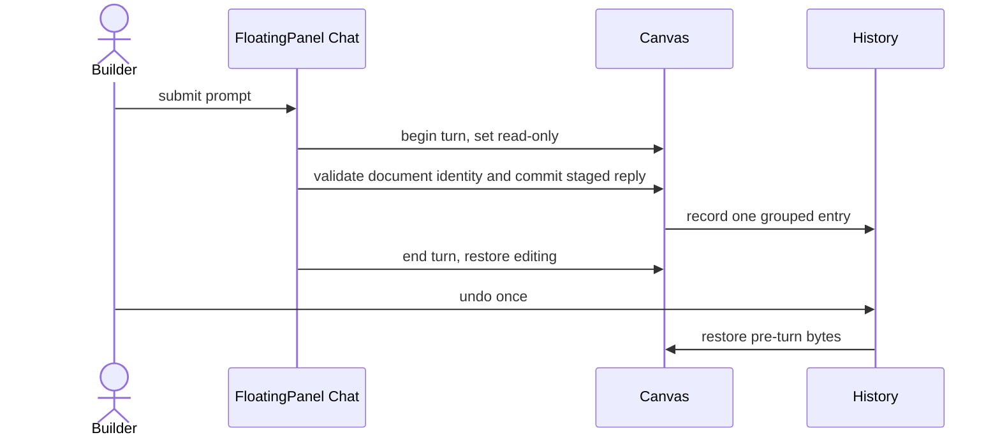
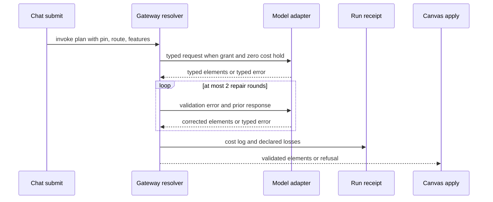
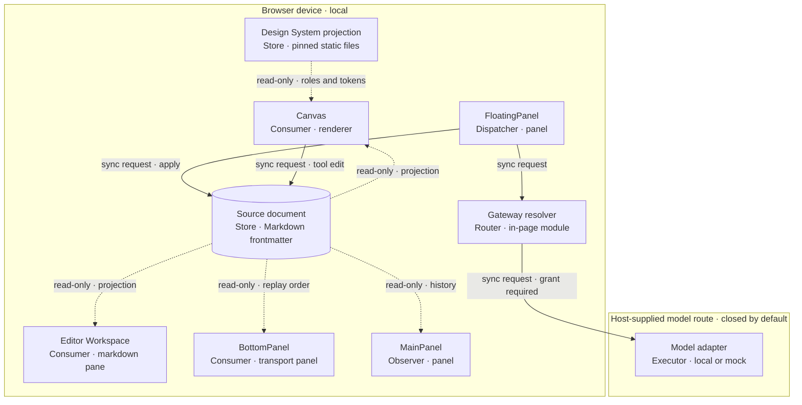
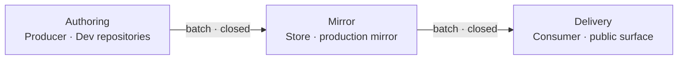

# Agentic-Graph — Native Canvas Authoring, Prompt-to-Canvas Turns and Replay

**Join:** `PRD-TAD-ADR-AGENTIC-GRAPH-CANVAS-AUTHORING-001@0.2.1`. One combined artifact; five addressable section roles.

A solo builder should be able to sketch a system, ask for one revision, inspect the resulting Markdown and undo the whole turn. This proposed increment uses the current Graph workspace, Gateway catalog and Design System. The MVP implementation record below tracks owner revisions, local acceptance checks and outstanding evidence.

## Identity and opening directive (CID)

**DIR-AG-CA-01** — Context: the Canvas already has an interaction contract, a tool rail, chat-driven document generation, timeline transport and on-device recording, but the tool rail is mostly inert, first-run discovery of the preset handoff is unmeasured, a chat apply has no turn boundary, and nothing replays how a graph was built (sources in the grounding record). Intent: make the document-as-program canvas directly authorable by hand and by prompt, with one reversible turn and a replay, using existing owners only. Directive: specify one increment across the Design System, Gateway and Graph that extends current owners, adds no fork or second variant, and stays at USD 0. Role: Product/Architecture author. Action: author defines scope, contracts, decisions and slice. Outcome: one baselinable plan with VCCs, owners and explicit gaps.

**Ranked next outcome (decision record)** — Next outcome: MVP slice F-01 to F-03 reaches `dev-proven` on the authoring surface. Uncertainty resolved: whether a starter prompt plus a locked, single-undo turn shortens time to a first usable diagram (H-01, H-02). Cheapest sufficient method: five timed first-run walkthroughs on a clean local build with the mock provider. Threshold and window: at least 3 of 5 reach an editable diagram in 60 s or less, one week after local proof. Stop or revisit: fewer than 3 of 5 stops Phase 4 onward and reopens P-02 and P-03. Bounds: USD 0; no paid provider; files under 600 lines, zero added always-load bytes and three alignment cycles maximum.

## Codebase Grounding Record — reference implementation

Inspection on 2026-11-28 used the native software-forensics workflow. The graph-editor subtree was parsed locally, and selected owner files were located by literal search and reread by SHA-256. Graph was clean. Gateway and Design System had unrelated untracked plans. The inspected owner bytes matched their commits. This record describes the pre-implementation baseline. Current verification appears in the MVP section.

### Native sources

| Owner at exact revision | Inspected path and symbol | Source fact | Disposition |
|---|---|---|---|
| `agentic-graph@ccca2de32872d8a8507be286422e5f9963ce1ff9` | `canvas/src/lib/canvas/interaction-ssot.ts` · `CanvasInteractionMode`, `CANVAS_PRECEDENCE_RULES` | Four modes. Space-drag pan overrides every mode | reuse |
| same | `canvas/src/features/graph-editor/GraphEditorToolRail.tsx` · `GraphEditorToolId` | Tools select, pan, node, edge, subgraph; icons imported directly from an icon package | extend-owner |
| same | `canvas/src/features/graph-editor/GraphEditorOverlay.tsx` and `canvas/src/features/toolbar/ToolbarToolMenuRendererView.tsx` · `toolId` state | Two separate holders of tool state; in the overlay every tool except pan maps to pointer mode `select` | converge |
| same | `canvas/src/features/graph-editor/plugins/toolRegistry.ts` · `registerGraphEditorTool` | Tool contribution seam carries id, label, hotkey and icon only | extend-owner |
| same | `canvas/src/features/edge-creation/authoring.ts` | Edge authoring owner exists | reuse |
| same | `canvas/src/features/chat/chatAgenticOsCanvasApply.ts` · `applyChatAgenticOsDocumentTextToCanvas` | Applies a generated document to the canvas; no reveal or lock term found | extend-owner |
| same | `canvas/src/features/chat/chatContextPack.ts` · `packChatContext` | Packs chat context; selection and hybrid scopes exist in the submit request | reuse |
| same | `canvas/src/features/chat/gatewayPresetCatalog.ts` | Chat already reads the pinned Gateway preset catalog | reuse |
| same | `canvas/src/hooks/store/historySlice.ts` · `undoHistory`, `redoHistory` | One history owner | extend-owner |
| same | `canvas/src/components/timeline/timelineAnimationEngine.ts` · `TimelineAnimationModifier` | `stroke-trim` modifier and rectangle, ellipse, polygon, star vector shapes exist | reuse |
| same | `canvas/src/components/timeline/videoSequenceExport.ts` | Records the canvas on-device through `captureStream` and `MediaRecorder` | reuse |
| same | `canvas/src/components/StoryboardWidgetCanvas/storyboardFixedCardCollisionLayout2d.ts` · `settleStoryboardFixedCardCollisionItems2d` | Rectangle collision settling exists; `dagre` is an installed layout dependency | reuse |
| same | `canvas/src/features/strybldr/StrybldrTimelineBottomPanel.tsx` · `TimelineBottomPanelView` | Ten BottomPanel views | extend-owner |
| same | `canvas/src/hooks/store/store-types/graph-state-chat-import.ts` · `FloatingPanelView`; `store-types/core.ts` · `EditorWorkspacePane` | Twenty-seven FloatingPanel views including chat and prompt presets; one Editor Workspace pane type, markdown | reuse |
| same | `canvas/src/features/voice-studio/voiceStudioBrowserRuntime.ts` | Detects browser speech synthesis and recognition | defer |
| same | `canvas/src` (lexical search) | The graph-editor rail lists five tools. Timeline vector shapes already exist. A source-backed freehand gesture on this rail remains unverified | trace the renderer before extending it |
| `agentic-design-system@c736e654576df5354fd1dfdb888dc7c587720cb3` | `site/icons.json` · `panelControls`, `icons` | Panel roles only; glyphs include Hand, Eraser, Type, Play; no pointer, shape, line or pen glyph | extend-owner |
| same | `guides/floating-panel-contract.md` | Consumers may not define glyph aliases, panel variants or visual overrides | binding constraint |
| `agentic-gateway@2b9a498292804fe15333f1f656e2c7c7a140b828` | `resolver.mjs` · `validateManifest`, `createResolver` | Refuses on missing feature; host supplies adapter and cost evidence | reuse |
| same | `connectors/profiles.json`, `catalog/PROMPT-PRESETS.md`, `transfer/browser-files.mjs` | One media-import profile; 17 presets; file download helpers | extend-owner |
| `agentic-os@2e91202a8dcc2b2651fc7e375413b295eeeeb448` | `catalog/dictionaries/DICTIONARY-COMMAND.md` · `/canvas.view.set` | The one Invocation Register; view selection route exists | reuse |

Graph consumes the Design System at `d3e2b027a68adc21cda6aef6eb39cbe958f5aaa2` and Gateway at `da61ed8f0af9d78c33d306311ab8beaa6563cfc8` (`canvas/package.json`); both trail the heads above.

### Inspection evidence and reference boundary

| ID and method | Finding and limit |
|---|---|
| E1 · browser observation, Nov 28, 11:04–11:06 SGT | On the supplied demo’s empty board, the browser showed a selected pointer, shape tools, four prompt suggestions and a disabled video action. At 1280 × 720 chat sat beside the canvas. At 390 × 844 it sat below a 479 px-high canvas. Only navigation and viewport size changed. Drawing, saving, generation and export were untested. |
| E2 · local reference files | The supplied snapshot’s `app/tests/e2e/board-workflow.spec.ts` (L62, SHA-256 prefix `05e8c8f31ae6`) describes edit, undo and reload. Its sibling `mobile-layout.spec.ts` (L35, `b3984442166f`) describes keyboard resize. The untracked snapshot has no verified upstream revision. These are test descriptions. Use the interaction goals only. All implementation, prompts, assets, schemas, tests and deployment stay native. |
| E3 · native ingest → query → explain | At Graph `ccca2de`, strict ingest of `canvas/src/features/graph-editor` parsed 10/10 files (34,605 bytes, 259 nodes, 249 edges, zero diagnostics). Graph `kg:graph:a61621e62f7edf1c00c7b611cf9c0d1c`, snapshot `1335c0f3f18dacb9e493693e941b98527a417924733ba7d7f19bc942a18a68f7`. A one-hop path and edge `kg:edge:3dc3af72d304366aa25e23280074` identify the overlay function declaration at L12–46. Parser `local-typescript-ast`, version `1.2.0+typescript-5.8.3+canonical-node-output-v1`. |
| E4 · exact-byte reads | At the owner revisions above, the overlay (L21–25, `bf1eb28e0d78`) and toolbar renderer (L74–83, `aa011cbe5adf`) independently store the tool and derive pointer mode. Surface-specific file anchors below give SHA-256 prefixes. Retrieve the full digest with `agentic-os context search` and pass it to `context read` on the same file. |
| E5 · owner checks | Gateway’s `node --test test/presets.test.mjs` passed both catalog tests. The OS shared-toolbar check passed. Fleet design conformance exited 1 on installed package pin drift in `agentic-base`. Neither a Graph gesture nor a delivered feature was exercised by these checks. |

## PRD

### Problem statement

A builder who opens the Canvas to sketch or explain a system meets four frictions. Tools on the rail look selectable but most do nothing, and two surfaces disagree about the active tool. Graph has preset pickers and a chat handoff. Whether first-time authors discover them from an empty document remains an open question. A chat-generated document lands on the canvas with no turn boundary and no single step to take it back. Explaining how a graph was built means recording the screen by hand. The opportunity is a short path from intent to an editable, source-owned diagram that can replay itself.

### Personas and jobs

| Persona | Job to be done | Current workaround |
|---|---|---|
| Thinker (builder, architect) | Get an editable diagram fast, then fix it by hand | Type a long prompt, or author frontmatter directly |
| Explainer (maintainer, trainer) | Show how a system fits together, step by step | Manual screen recording |
| Operator (solo owner) | Keep every change reversible and in Git | Review document diffs after the fact |

### Pain-point-to-feature mapping

All pain is `unvalidated`; each row is a bounded learning hypothesis. P-01 additionally has source-inspection problem evidence.

| Pain | Hook | Break | Fix | Close | Reuse-or-build note |
|---|---|---|---|---|---|
| P-01 Tools do nothing; tool state diverges | "Pick a tool, it works" | Rail tools other than pan fall back to select | F-01 | The picked tool authors an element and both surfaces agree | Reuse rail, registry, edge authoring; build one store field and role map |
| P-02 Starters are hard to find | "Start from one click" | Discoverability on an empty authoring canvas is unmeasured | F-02 | A starter fills the prompt without invoking a model | Reuse the catalog, its picker and composer handoff. Surface up to four authoring intents at the empty-document entry |
| P-03 A prompt can change the canvas with no turn boundary | "One turn, one undo" | No lock or grouped history found | F-03 | Canvas is read-only during the turn; one undo restores prior bytes | Reuse apply owner and history; build lock and grouping |
| P-04 Explaining a graph needs manual recording | "Press replay" | No creation-order playback | F-06 | Elements replay in authored order and record on-device | Reuse animation engine and recorder; bind authored order to the existing transport |

Ranking: P-01 first (nearest to built, source-evidenced), then P-03, P-02, P-04. Willingness to pay is unknown for all four.

**User journey stage**: journey "Thinker — first editable diagram" runs Open → Start → Draw turn → Edit → Replay. F-01 serves Edit, F-02 Start, F-03 Draw turn, F-06 Replay.

### User stories and acceptance criteria

| ID | Story and criterion | VCC |
|---|---|---|
| VCC-01 (F-01) | As a thinker I pick a tool once. Given the editor is open, when I select node, edge or subgraph on either tool surface, then both surfaces show it and using it creates that element | Verify one store field owns the active tool and node, edge and subgraph tools author an element by `npm run test:ci:unit` in `agentic-graph/canvas` (the Graph unit suite) exiting 0 with no change to renderer selection behavior |
| VCC-02 (F-01) | Given the rail renders, then every tool glyph, label and hotkey resolves from the pinned Design System role map | Verify no tool-role glyph is defined in Graph by `node scripts/check-design-conformance.mjs <workspace>` exiting 0 with no local token or icon override |
| VCC-03 (F-02) | On an empty graph offer at least three eligible catalog starters. Choosing one fills the existing FloatingPanel composer. Selecting from a nonempty document preserves its selection and source bytes | Rehearse offline after local assets load. Count zero model calls and document writes on selection. A stale digest produces a visible error and preserves the draft. Run Gateway and Graph checks |
| VCC-04 (F-03) | On explicit submit, bind the turn to the active document key and source digest. Guard Canvas and Editor Workspace writes during apply. Keep navigation and Cancel available. Stage and validate the complete reply before committing once | In Graph tests inject cancel, invalid output, a changed draft, document switch, duplicate delivery and late completion. Expect zero committed edits on refusal and an editable workspace. On success expect one history step and equal pre-turn and post-undo source hashes. Check the other document’s hash too |
| VCC-05 (F-07) | MainPanel History shows one completed turn with its element count and links to the affected source selection when provenance is available | Check that the row reads the existing history entry. A legacy entry without turn metadata keeps its current label and restore action |
| VCC-06 (F-04) | Given I draw a shape, line, text or stroke, when I save and reload, then the document bytes are identical | Verify byte-identical round trip by the Graph unit suite exiting 0 with strokes under a declared byte cap |
| VCC-07 (F-05) | Regenerate a 12-node diagram after moving one node. Preserve its ID, coordinates and manual styling. Place new siblings clear of it and retain connector endpoints | Repeat with identical input and compare document hashes. Exercise a cycle and a missing target. Reject either before writing. Exempt deliberate containment from sibling collision checks |
| VCC-08 (F-06) | Play, pause and seek in the BottomPanel. After deleting an element, replay the surviving stable IDs once in authored order. Opening replay leaves the source hash and undo depth unchanged | With the network offline, compare the first and last frame to expected IDs and export a nonempty recording on a supported browser. When recording is unavailable keep playback usable and explain the export limitation |

### Success metrics

| Metric | Baseline | Target | Timeline |
|---|---|---|---|
| First-run diagrams usable without manual cleanup | unmeasured | at least 4 of 5 | one week after MVP local proof |
| Readiness rung (local / delivered) | `spec-complete` / `undocumented` | `dev-proven` / `undocumented` | MVP |
| Time-to-value (TTV steps) | 5 (estimate from source; never walked) | 2 or fewer | MVP; clean-environment walkthrough before Phase 3 sign-off |
| Time-to-value (TTV elapsed) | unmeasured | 60 s or less on the mock provider | MVP |
| Token cost / month | USD 0 (no route selected) | USD 0 | all phases |
| Monthly TCO | USD 0 | USD 0 | all phases |
| ROI score | — | not computed: Reach has no evidence until H-01 runs | after H-01 |

**Agent experience assessment** — rubric revision: Agent Experience Maturity module at guideline `3.5.1`. All four ratings are `unassessed` at this revision: no evaluator-observed experience exists. Domain object: a source-owned graph document and one reversible draw turn. Gap owner: Graph. Next check: the five timed walkthroughs.

### MoSCoW priority

| Tier | Features | Rationale |
|---|---|---|
| Must | F-01 tool roles and single tool state · F-02 starter prompts · F-03 turn-taking apply with one-step undo | Smallest diffs over built owners; resolve P-01 to P-03 |
| Should | F-04 sketch primitives · F-05 relation-based placement and element-generation capability · F-06 replay · F-07 turn receipt and tool hotkeys in help | Larger builds; depend on Must |
| Could | F-08 narrated beats · F-09 scene export · F-10 source reveal and context preview for generated elements | Value depends on F-04 to F-06 |
| Won't (this increment) | Real-time multi-user drawing changes · raster image generation · hosted render or speech services · any embedded third-party drawing surface · a new renderer, panel shell, tool registry or chat surface | Outside USD 0 or the one-owner rule |

**Min-viable scope**: F-01, F-02, F-03 at VCC-01 to VCC-04. **Out of scope**: every Should, Could and Won't row.

### Dependencies, ecosystem outcome and reuse outcome

- **Dependencies**: a pinned Design System tool-role export, three eligible starters in the pinned Gateway catalog, and a passing fleet design-conformance check. Release and repin the owner only when its bytes change.
- **Ecosystem outcome and evidence**: the solo builder is both user and operator. Willingness to pay is untested. Value exchanged is time to a usable, reversible diagram. Evidence is hypothesis only; the measurable outcome and window are the ranked next outcome above. Joins the TAD Ecosystem Contract at `@0.2.1`.
- **Reuse outcome**: observed duplication is two holders of tool state, plus direct icon imports where a central role map is required. Baseline and target integration time, repeated actions and support cost are unmeasured, so savings stay unclaimed. Joins the TAD reuse record.

### Open questions

1. Resolved for the MVP. Gateway binds the process, dependency, sequence and decision starters to the existing source-backed `/canvas.project` command. Selecting a starter prepares editable Markdown in Chat. Submitting it projects that source locally.
2. Which existing 2D renderer hosts sketch primitives?
3. Can a local speech route be captured into a recording at USD 0?
4. What byte cap applies to one freehand stroke in frontmatter?

## TAD

### Overview

**From a tool pick or a prompt to a source-owned, replayable document**: builder → tool rail or FloatingPanel Chat → typed elements → relation resolver → Markdown frontmatter → Canvas projection → BottomPanel replay.

### Flow classification

| Feature | User journey | Workflow | Data flow | Orchestration/harness | Topology |
|---|---|---|---|---|---|
| F-01 | applicable (D-01) | N/A: single direct manipulation, no multi-step process | N/A: no schema boundary crossed | N/A: no AI pipeline | applicable (D-05) |
| F-02 | applicable (D-01) | N/A: one selection | applicable (D-03, catalog to prompt) | N/A: selection makes no model call | applicable (D-05) |
| F-03 | applicable (D-01) | applicable (D-02) | applicable (D-03) | applicable (D-04) | applicable (D-05) |
| F-04 to F-06 | applicable (D-01) | N/A at this revision: specified when promoted to Must | applicable (D-03) | applicable for F-05 (D-04) | applicable (D-05) |

### Journey → system mapping

| Journey stage | Workflow | Data flow | Orchestration/harness flow | Topology node(s) | Component |
|---|---|---|---|---|---|
| Open | N/A: no action | N/A | N/A | `canvas` | Canvas |
| Start | N/A: one selection | D-03 `df_catalog` | N/A: zero model calls | `gateway`, `floating` | Preset catalog, FloatingPanel |
| Draw turn | D-02 | D-03 | D-04 | `floating`, `gateway`, `model`, `canvas`, `source` | Chat apply, resolver, history |
| Edit | N/A: direct manipulation | N/A | N/A | `canvas`, `design`, `source` | Tool rail, tool state |
| Replay | N/A at this revision | D-03 `df_doc` | N/A | `bottom`, `source` | Replay transport |

### Diagrams

Surface: static Markdown renderer. No interactive graph canvas surface is declared, so no projection is claimed. Shape vocabulary: rectangle is a component, rounded is an actor, cylinder is a store. Solid edges are runtime calls; dotted edges are derived relationships.

**Diagram D-01** · Class: Journey stage map · Notation: flowchart LR · Version: 1 — 2026-11-28
**Caption**: The User Journey Flow reaches a first editable diagram in two actions after opening.

```mermaid
flowchart LR
  j_open("Open empty canvas<br/>Actor · journey stage")
  j_start("Pick starter prompt<br/>Actor · journey stage")
  j_turn("Watch locked draw turn<br/>Actor · journey stage")
  j_edit("Edit with tool rail<br/>Actor · journey stage")
  j_replay("Replay in authored order<br/>Actor · journey stage")
  j_open -->|"sync request · one action"| j_start
  j_start -->|"sync request · one action"| j_turn
  j_turn -->|"sync request · optional undo"| j_edit
  j_edit -->|"sync request · optional"| j_replay
```

| Node | Stage | Touchpoint | Feature |
|---|---|---|---|
| `j_open` | Open | Canvas | — |
| `j_start` | Start | FloatingPanel | F-02 |
| `j_turn` | Draw turn | FloatingPanel Chat, Canvas | F-03 |
| `j_edit` | Edit | Tool rail | F-01 |
| `j_replay` | Replay | BottomPanel | F-06 |

**Diagram D-02** · Class: User workflow · Notation: sequenceDiagram · Version: 1 — 2026-11-28
**Caption**: The Workflow Flow makes a draw turn one locked, cancellable, single-undo unit.

| Participant | Role · type | Happy path | Alternate path | Error path |
|---|---|---|---|---|
| `w_builder` | Actor · person | Submits, then edits | Cancels before commit and discards staged output | Sees a readable refusal |
| `w_chat` | Dispatcher · panel view | Opens and closes the turn | Ends the turn on cancel | Ends the turn on failure; never leaves the lock set |
| `w_canvas` | Consumer · renderer | Read-only during the turn | Editing restored on cancel | Editing restored on failure |
| `w_history` | Store · state slice | One entry per committed turn | Zero entries for cancelled staging | No entry for a rejected reply |

**Diagram D-03** · Class: Data flow · Notation: flowchart LR · Version: 1 — 2026-11-28
**Caption**: The Data Flow carries no coordinates from the model; geometry is resolved locally before the document is written.

```mermaid
flowchart LR
  df_catalog[("Preset catalog<br/>Store · pinned index")]
  df_prompt["Prompt and scene digest<br/>Producer · typed request"]
  df_elements["Typed elements and relations<br/>Producer · typed response"]
  df_resolver["Relation resolver<br/>Router · pure function"]
  df_doc[("Markdown frontmatter<br/>Store · source document")]
  df_canvas["Canvas projection<br/>Consumer · renderer"]
  df_catalog -->|"read-only · preset body"| df_prompt
  df_prompt -->|"sync request · typed request"| df_elements
  df_elements -->|"sync request · no coordinates"| df_resolver
  df_resolver -->|"sync request · typed nodes and edges"| df_doc
  df_doc -.->|"read-only · derived projection"| df_canvas
```

| Stage | Input schema | Output schema | Owner |
|---|---|---|---|
| `df_catalog` | preset id | prompt body, SHA-256 checked | Gateway |
| `df_prompt` | prompt text, selection or hybrid context | typed request | Graph chat context pack |
| `df_elements` | typed request | element list with ids and relations (right-of, below, inside; gap preset) | Host-supplied adapter behind the Gateway resolver |
| `df_resolver` | element list, current node rectangles, pinned flags | positions with zero overlaps | Graph |
| `df_doc` | positions and elements | frontmatter nodes and edges | Graph source document |
| `df_canvas` | frontmatter | rendered view | Graph Canvas |

**Diagram D-04** · Class: Orchestration / harness flow · Notation: sequenceDiagram · Version: 1 — 2026-11-28
**Caption**: The Orchestration/Harness Flow is sequential, bounded to two repair rounds, and refuses before any call when cost evidence is missing.

| Role | Component | Input schema | Output schema | Cost log | Fallback |
|---|---|---|---|---|---|
| Dispatcher | Chat submit (`h_dispatch`) | prompt, context scope | invoke plan | — | typed refusal shown in chat |
| Router | Gateway resolver (`h_router`) | plan, native request, grant | capability, revision, losses, response | — | `missing_feature` or cost refusal before any call |
| Executor | Host-supplied model adapter (`h_exec`) | typed request | typed element list | required | typed error; deterministic mock provider |
| Observer | Run receipt (`h_observe`) | cost log | receipt row | — | missing log blocks the apply |
| Consumer | Canvas apply (`h_consume`) | validated elements | one grouped history entry | — | no apply; canvas unchanged |

**Pipeline**: element generation. **Topology pattern**: sequential. **Max iterations**: one call plus two repair rounds. **Circuit-breaker**: second consecutive validation failure, 120 s wall clock, or cancel. **Token budget**: ceilings of 8,000 prompt and 4,000 completion tokens per call (declared, unmeasured); cache hit rate unknown; estimated cost USD 0 on a local or mock route, otherwise blocked.

**Diagram D-05** · Class: Runtime topology · Notation: flowchart TB · Version: 1 — 2026-11-28
**Caption**: The MVP runs on the device. Generation requires an explicitly selected local or mock route.

| Node | Role | Type | Lane | Connects to | Connection type | Data residency |
|---|---|---|---|---|---|---|
| `canvas` | Consumer | renderer | Authoring | `source` | sync, read-only | Local |
| `editor` | Consumer | markdown pane | Authoring | `source` | read-only | Local |
| `floating` | Dispatcher | panel | Authoring | `gateway`, `source` | sync | Local |
| `bottom` | Consumer | transport panel | Authoring | `source` | read-only | Local |
| `main` | Observer | panel | Authoring | `source` | read-only | Local |
| `gateway` | Router | in-page module | Authoring | `model` | sync | Local |
| `design` | Store | pinned static files | Authoring | `canvas` | read-only | Local |
| `source` | Store | Markdown frontmatter | Authoring | `canvas`, `editor`, `bottom`, `main` | read-only | Local |
| `model` | Executor | local or mock adapter | Authoring | — | — | Local for this increment |

**Diagram D-06** · Class: Lane & deploy boundary · Notation: flowchart LR · Version: 1 — 2026-11-28
**Caption**: The Lane Topology has three lanes and both boundaries stay closed for this increment.

Inventory: the Deploy Boundary Register below lists every lane and boundary drawn.

### Component specifications and inventory

Paths under `agentic-graph` are relative to `canvas/src`. Every component is extend-owner unless noted; delivered rung is `undocumented` for all.

| ID · layer | Component and responsibility (SVO) | Owner · file or module | VCCs | Local rung |
|---|---|---|---|---|
| C-01 · Design | Tool role map defines glyph, label and hotkey per canvas tool | Design System · `site/icons.json` | VCC-02 | `spec-complete` |
| C-02 · State | Tool state store holds the active tool; removes the two local holders | Graph · `hooks/store/canvasSlice.ts` | VCC-01 | `spec-complete` |
| C-03 · Canvas | Tool registry dispatches pointer input to the active tool | Graph · `features/graph-editor/plugins/toolRegistry.ts` | VCC-01, VCC-06 | `spec-complete` |
| C-04 · Catalog | Preset catalog supplies starter prompts | Gateway · `catalog/PROMPT-PRESETS.md` | VCC-03 | `spec-complete` |
| C-05 · Panel | Empty authoring entry offers catalog suggestions via the existing preset selection runtime | Graph · `features/chat/promptPresetSelectionRuntime.ts`, `features/toolbar/FloatingPanelPromptPresetsView.tsx` | VCC-03 | `spec-complete` |
| C-06 · Chat | Turn controller locks the canvas and groups history | Graph · `features/chat/chatAgenticOsCanvasApply.ts`, `hooks/store/historySlice.ts` | VCC-04, VCC-05 | `spec-complete` |
| C-07 · Gateway | Element-generation profile declares features, losses and requirements | Gateway · `connectors/profiles.json` | VCC-07 | `undocumented` |
| C-08 · Layout | Relation resolver places elements without overlap (reuse plus one pure function) | Graph · module to be named in the owner lane | VCC-07 | `undocumented` |
| C-09 · Panel | Replay maps authored IDs to the existing transport clock | Graph · `features/strybldr/StrybldrTimelineBottomPanel.tsx`, `features/gitgraph/GanttTimelineTransportPanel.tsx` | VCC-08 | `undocumented` |

C-01 to C-06 specify the Must slice. C-07 to C-09 describe conditional follow-on work. The native source anchors and consumer-specific changes for all five Graph surfaces appear under [Native changes by authoring surface](#native-changes-by-authoring-surface).

**Harness contract (C-07 with the host adapter)** — input: `{ prompt, context_scope, scene_digest }`; output: `{ elements[], relations[] }` with no coordinates; cost log: `{ model, prompt_tokens, completion_tokens, cache_hits, estimated_cost_usd }`; fallback: typed refusal, canvas unchanged.

**Integration contracts** — Design System → Graph: exact package pin and projection bytes (JSON role map, CSS); the conformance check fails closed. Gateway → Graph: exact package pin with `discover`, `invoke` and preset `list` and `select` (JSON, content-addressed text); typed refusal, and a digest mismatch rejects. Chat → Canvas: in-page call carrying Markdown frontmatter text; the document owner checks the turn ID, active key and pre-turn bytes at commit. A stale callback cannot write or unlock a newer turn. Stage incomplete output outside the document and release the matching guard on every terminal path.

### Ecosystem contract

| Participant / job | Value exchange / payer | Native owner / exact revision | Interface / authority | Current evidence / gap | Cost, privacy and exit |
|---|---|---|---|---|---|
| Builder / author a diagram | Time saved / none | Graph `ccca2de` · tool rail, chat apply | Browser UI / edits the active local document only | None; VCC-01, VCC-04 unproven | USD 0; local; undo |
| Operator / keep changes reversible | Auditability / none | Graph `ccca2de` · history, source document | Git-backed document / no remote write | None; VCC-04 unproven | USD 0; local; revert |
| Agent / generate elements | Structured output / none | Gateway `2b9a498` · resolver | Typed invoke / refused without grant and zero cost | Resolver reuse only; profile proposed | USD 0 or blocked; prompt stays on device on a local route |
| Model provider / execute | none selected | Host-supplied adapter | Closed by default | No provider selected; mock only | Unknown cost blocks the effect |

**Developer path**: discovery through the Gateway `discover` call → local rehearsal on the mock provider → invocation through the resolver → receipt in the run log → support in the owner repository → retirement by profile major version. **Invocation join**: the one Invocation Register in `agentic-os`; this increment adds no `/`, `#` or `@` route, and Canvas view selection reuses `/canvas.view.set`. BottomPanel playback belongs to its existing transport. **Unsupported**: remote mutation, hosted speech, offline generation without a local model. **Dependency order**: Design System and Gateway are disjoint and release in parallel → Graph pins both → Graph features. **External seams**: none adopted; reference provenance recorded above.

### Shared utility and invocation reuse

| Capability / pain-VCC | Source export / revision / consumers | Decision / smallest delta | Runtime boundary / differences | Acceptance check / removal |
|---|---|---|---|---|
| Tool roles / P-01, VCC-02 | Design System `site/icons.json` `c736e65`; consumed by Graph at pin `d3e2b02` | extend-owner / add a canvas tool role map | view; browser-safe static data | conformance exits 0; remove direct tool-glyph imports from the rail |
| Tool state / P-01, VCC-01 | Graph canvas store | extend-owner / one field | domain; browser only | unit suite; remove both local `toolId` holders |
| Starter prompts / P-02, VCC-03 | Gateway `presets` export `2b9a498`; consumed by Graph at pin `da61ed8` | reuse first / add only missing presets, four intents maximum | pure data; browser and Node | Gateway `npm test`; no prompt text in Graph |
| Element generation / VCC-07 | Gateway `createResolver` | extend-owner / one profile | transport-neutral; host adapter holds any secret | refusal cases tested; none removed |

| Register join / capability | Surface and name | Contract / dispatch owner | Mode / effect boundary | Evidence / unsupported reason |
|---|---|---|---|---|
| `/canvas.view.set` | Browser, WebMCP tool `agentic-graph.control_local_canvas_view` | existing option id / toolbar selection owner | supported / local view state only | existing register row for Canvas view options only |
| Starter presets | `/<id>-prompt-preset` in the preset catalog | preset schema / chat | prepare-only / fills the prompt, no call | Gateway records the four starter bindings and verifies the selected body digest |
| Element generation | Gateway `invoke` | profile schema / resolver | unsupported until a zero-cost route is proven | no route selected |

**Compatibility cases**: unknown tool id, duplicate registration, digest mismatch on a preset body, cancel during apply, failure during staging or commit, undo across a turn boundary, regeneration with pinned nodes. **Migration and recovery**: owner export and check → exact Graph pin → adapter; remove replaced code in the same change; rollback restores the prior pins and reverts the pull request. **Budgets**: no always-loaded module added; incremental always-load bytes 0, new views load on demand, each code chunk stays under 500 kB, each changed file under 600 lines, USD 0.

### Value-moving flow and policy evidence

Not applicable: no asset, payment or settlement moves in this increment. Reviewer: Solo Founder / AI Orchestrator. Recorded once in coverage row C13.

### Native changes by authoring surface

All Graph paths below are relative to `canvas/src`. File digests are prefixes of the exact-byte reads in E4. Every row describes a proposed change with an observable acceptance case.

| Surface and native owner | Smallest change and acceptance |
|---|---|
| **Canvas** · `features/graph-editor/GraphEditorOverlay.tsx` and `features/toolbar/ToolbarToolMenuRendererView.tsx` (E4) | F-01. Move the rail and menu to one active tool in the Canvas store. Dispatch node and edge intents through the owners behind `/canvas.node.add` and `/canvas.node.link`. Use `createSubgraph` in `lib/graph/subgraphs.ts` for a selected group. Preserve Space-drag pan and the per-renderer pointer preference. Pick an edge on one surface, connect two nodes on the other and verify one edge after reload. |
| **Editor Workspace** · `features/markdown-workspace/useCanvasMarkdownSync.ts` L204 (`80888b5dd407`) | F-03 protects the active Markdown draft. F-10 extends the existing node/edge source reveal to generated IDs through `/canvas.selection.open`. Resolve the current document and line range on demand. With an unsaved draft or ambiguous source, preserve the text and report the conflict. A valid selection reveals the corresponding stanza in the existing pane. |
| **MainPanel** · `features/panels/views/HistoryView.tsx` L48 (`0d485b6ab5f1`) | F-07. Show one committed turn and its element count in History. Reuse the history slice for restore and the Help tab for tool shortcuts. One undo removes only that turn. Legacy manual entries remain readable. |
| **BottomPanel** · `features/design/DesignTimelineBottomPanelView.tsx` L25 (`8714c13126d6`) | F-06. Follow this existing read-only transport binding. Derive beats from committed element IDs, use the same clock for scrubbing and recording, and label legacy documents with unavailable creation order. Switching documents stops the old playback. Verify VCC-08 before offering export. |
| **FloatingPanel** · `features/toolbar/FloatingPanelPromptPresetsView.tsx` L36 (`fb81488a6988`) | F-02/F-03. The home preset picker and this panel already share `features/chat/promptPresetSelectionRuntime.ts` (L12, `136797ec4a8d`). Reuse the catalog-to-chat handoff with `submit: false`. Offer starter intents for a process, dependency map, sequence or decision. Prepare a selection-scoped follow-up through the existing context pack. A deliberate submit starts the turn. Preserve typed drafts on cancel or stale catalog reads. |
| **Gateway** · `presets.mjs` L33 (`ca69952c3683`), `catalog/PROMPT-PRESETS.md`, `resolver.mjs` | Prefer matching entries first. Author only missing prompt bodies upstream and use their digest-verified projection. F-05 adds a generation profile only after the MVP passes. The resolver checks features, cost and locality. The host checks the grant before starting generation. Exercise both refusal paths and assert zero model calls. The manual tools and starter text stay available offline. |
| **Design System** · `guides/floating-panel-contract.md` L9 (`6c8242ce49ff`), `site/icons.json` | Add missing tool presentation roles upstream, then pin the export in Graph. Use the shared placement, focus, selected-state and size tokens. At 390 × 844 with the on-screen keyboard and at 1280 × 720 with keyboard-only input, verify the tool name, active state, visible selection and reachable Cancel. Use the same existing panel shells on both devices. |

### Quality attributes

| Attribute | Scenario | Pattern | Validation |
|---|---|---|---|
| Performance and scale | Tool switch and turn lock respond within one frame; a 12-node generated diagram resolves without overlap | Store field with no re-layout; deterministic resolver | browser smoke; VCC-07 |
| Security | Generated text is untrusted data | Schema validation before apply; no script execution; sanitization owner to be confirmed in the lane | refusal-case tests |
| Observability | Every turn leaves a receipt | History entry and cost log | VCC-05 |
| Token cost | 8,000 plus 4,000 token ceiling per call | Harness, refusal before call | cost log sampling |
| Offline behaviour | Tools, presets, undo and replay work offline; generation needs a local model | Local-first document | airplane-mode pass |
| TCO | USD 0 for 12 months on the local model; no managed variant selected | FOSS-first, no hosted service | monthly check of receipts |
| Device reach | Mobile browser, coarse pointer | Design System panel geometry; unverified for the tool rail | cross-device manual pass |

### Deployment strategy

This guide changes planning documentation. Future implementation uses the existing protected owner lanes and exact consumer pins. A source rollback reverts the affected Graph change and restores its prior pins while preserving authored documents. Any later product delivery requires the Graph-owned `docs/agentic-graph-acos-deploy-runbook.md`, a verified predecessor from `docs/production-rollback-baseline.md` and separate environment authorization.

### Diagram register

No canvas-renderable claim is made, so projected counts are zero; the counts below are drawn elements.

| Diagram | Class | Notation | Surface | Projects | Nodes | Edges | Clusters | Version |
|---|---|---|---|---|---|---|---|---|
| D-01 | Journey stage map | flowchart LR | static | no | 5 | 4 | 0 | 1 |
| D-02 | User workflow | sequenceDiagram | static | no | 4 | 7 | 0 | 1 |
| D-03 | Data flow | flowchart LR | static | no | 6 | 5 | 0 | 1 |
| D-04 | Orchestration / harness flow | sequenceDiagram | static | no | 5 | 7 | 1 | 1 |
| D-05 | Runtime topology | flowchart TB | static | no | 9 | 9 | 2 | 1 |
| D-06 | Lane & deploy boundary | flowchart LR | static | no | 3 | 2 | 0 | 1 |

### Deploy boundary register

| Boundary | From lane | To lane | Evidence Reference | Operator instruction | Rollback statement | State |
|---|---|---|---|---|---|---|
| Publish mirror | Authoring | Mirror | none | none | restore prior mirror revision; release workflow check | `closed` |
| Activate delivery | Mirror | Delivery | none | none | redeploy rollback predecessor; browser verification | `closed` |

## ADR

### ADR-01: Extend native owners; embed no third-party drawing surface and add no renderer

**Status**: Proposed · **Date**: 2026-11-28

**Context**: Direct authoring is missing, and a ready-made drawing surface would deliver it fastest. The constraints are one owner per capability, source-owned documents, USD 0, and no external dependency. **Decision**: Add tools through the existing rail, registry and store; host sketch primitives in one existing 2D renderer; write every element to frontmatter.

| Alternative | Constraint gate | Pros / cons |
|---|---|---|
| Embed a third-party drawing component (FOSS) | `fail-no-external-dependency`, `fail-single-owner` | Fast; but a second scene format and a second tool surface |
| New drawing renderer | `fail-single-owner` | Clean slate; but a duplicate of existing canvas, tool and history owners |
| Extend existing owners (chosen) | pass | Smallest delta; slower polish |

**Rationale**: Only the chosen option passes every gate. **Reuse compatibility**: direct owner reuse; the two local tool-state holders are removed; rollback is a pin and pull-request revert. **TCO impact** (estimate, local variant, 12 months): infrastructure, egress and token cost USD 0 for both the chosen option and the embedded component, delta 0; ops burden Low against Medium (format bridge); vendor risk Low against Medium. **Consequences** — positive: one document format, one tool state. Negative: drawing polish arrives later. Neutral: the registry contract grows. **Revisit**: if VCC-06 cannot hold a byte-identical round trip within the stroke cap.

### ADR-02: Place generated content by relation, resolved deterministically

**Status**: Proposed · **Date**: 2026-11-28

**Context**: A model that emits positions can produce overlapping layouts, and nothing local corrects them. **Decision**: The generation contract carries element ids and relations only; a local pure function resolves positions, settles collisions and keeps hand-moved nodes pinned.

| Alternative | Constraint gate | Pros / cons |
|---|---|---|
| Model emits coordinates | pass | No resolver; overlap depends on the model |
| Screenshot feedback loop | `fail-zero-spend` (unbounded extra calls) | Self-correcting; costly and slow |
| Relation plus resolver (chosen; FOSS, existing dependency) | pass | Deterministic and testable; needs a relation vocabulary |

**Rationale**: Chosen outranks coordinates on the overlap criterion (VCC-07) and is not worse on cost; the two are otherwise comparable. **Reuse compatibility**: reuse of the existing collision settle and layout dependency; no extraction. **TCO impact**: USD 0 for both passing options; ops burden Low. **Consequences** — positive: testable placement. Negative: free-form sketches need explicit coordinates by hand. **Revisit**: if 12-node diagrams still overlap in tests.

### ADR-03: Record replay on the device; defer narration

**Status**: Proposed · **Date**: 2026-11-28

**Context**: Replay needs export; narration needs captured speech. **Decision**: Reuse the existing on-device recorder for replay. Defer narrated export until a local speech route can be captured at USD 0.

| Alternative | Constraint gate | Pros / cons |
|---|---|---|
| Hosted speech provider | `fail-zero-spend` | Good voices; paid and remote |
| Separate render pipeline dependency | `fail-no-external-dependency` | High-quality output; new toolchain |
| On-device recorder, captions only (chosen; platform API) | pass | Works offline; container format depends on the browser |

**Rationale**: Only the chosen option passes. **Reuse compatibility**: direct reuse; nothing removed. **TCO impact**: USD 0; ops burden Low. **Consequences** — positive: offline export. Negative: no voice track in this increment. **Revisit**: open question 3 answered yes.

## MVP

### MVP: Authorable canvas and one reversible prompt turn

**Projects**: PRD Must features F-01 to F-03 · TAD components C-01 to C-06 · ADR-01 at `PRD-TAD-ADR-AGENTIC-GRAPH-CANVAS-AUTHORING-001@0.2.1`.

| Feature | VCC | Evidence Reference | Local rung | Delivered rung |
|---|---|---|---|---|
| F-01 | VCC-01 | The Graph regression reparses authored topology. Desktop D3 pointer gestures placed two nodes, connected them and created a subgraph. The unfiltered local run reported 29 failing cases before a missing browser API stopped it. The base comparison reproduced all 29 case names. | `spec-complete` | `undocumented` |
| F-01 | VCC-02 | The Design System integration gate passed. Fleet conformance stops on the Base consumer pin. | `spec-complete` | `undocumented` |
| F-02 | VCC-03 | Gateway catalog and Graph regression check four starters and digest refusal. Desktop and mobile Chromium exercised FloatingPanel selection. Mobile touch also repeated a prepared starter with networking disabled after loading local assets. | `spec-complete` | `undocumented` |
| F-03 | VCC-04 | Graph regression checks cancellation, draft and source conflicts, a document switch, late delivery and exact-byte undo. Chromium exercised explicit submit and undo. | `spec-complete` | `undocumented` |

**Implementation evidence, 2026-11-28.** The five tool roles are on the Design System protected branch at `ce684556`. The four catalog starters are on the Gateway protected branch at `b53cb683`. Both owner checks passed. [Design System PR 117](https://github.com/huijoohwee/agentic-design-system/pull/117) · [Gateway PR 37](https://github.com/huijoohwee/agentic-gateway/pull/37).

Graph projects the starter’s editable source on the device. The focused command is `npm -C canvas run test:ci:unit -- canvas.graphAuthoring.mvp`. Graph review revision `ecf43ea39` passed all 83 focused checks and both XR browser checks after Explorer kept ownership of its address-bar update. Its service worker precaches 26 JavaScript files totaling 6,267,694 bytes, 146 fewer than the archived base. The full-app rehearsal completed five actions in 46.2 seconds on desktop and 16.5 seconds on 390-pixel mobile. Both recorded two local receipts and reloaded offline. An earlier mobile attempt hit the editor overlay when tapping Preview. Three subsequent mobile pointer checks reached Preview. A repeat cold start stopped before import during source restoration, which also occurred on archived protected build `d4b2d7223`. All 30 source-projection and document-switch checks passed. Browser rehearsals started with an empty in-memory graph. A process starter applied three nodes and two edges, and one undo restored the original bytes on desktop and mobile Chromium. The five participant walkthroughs and the USD 1 experiment are still open. [Graph PR 2158](https://github.com/huijoohwee/agentic-graph/pull/2158) · [Hosted checks for the review revision](https://github.com/huijoohwee/agentic-graph/actions/runs/46111481878).

**Demo skeleton** (budget 120 s)

| Beat | Bound | Content |
|---|---|---|
| Hook | 15 s | An empty canvas shows three starter prompts |
| Probe | 20 s | Choose one; the prompt fills with no model call |
| Reveal = VCC-04 | 40 s | Submit; the canvas goes read-only, elements land, one undo restores the prior bytes |
| Connect two nodes | 30 s | Pick the edge tool; both tool surfaces agree; an edge is authored |
| Close | 15 s | The document diff shows the edge as source |

**Domain-object rubric**: unassessed; blocker for any rating is the absence of an observed walkthrough (owner Graph). **Min-viable scope**: F-01 to F-03. **Won't (this increment)**: the Won't row of the PRD.

### Roadmap

**Owner and join**: one product-owned roadmap at `PRD-TAD-ADR-AGENTIC-GRAPH-CANVAS-AUTHORING-001@0.2.1`. Active-time figures are estimates.

| Phase / outcome | Pain evidence / rank | Reuse / new delta / owner | Prerequisite / exit VCC | Bounds / wait condition | Stop, recovery / next check |
|---|---|---|---|---|---|
| 1 Tools work and agree | P-01 hypothesis with source evidence / 1 | Icon registry, rail, registry / role map and one store field / Design System, then Graph | green conformance gate / VCC-01, VCC-02 | 1 day; USD 0; no always-loaded module / waits on pin drift fix, recheck at next fleet check | conformance still red after fix: stop / revert pins |
| 2 One reversible turn | P-03 hypothesis / 2 | Apply owner, history / lock and grouping / Graph | none / VCC-04 | 1 day; USD 0 | lock cannot be released on failure: stop / revert |
| 3 Start from a chip | P-02 hypothesis / 3 | Preset catalog, picker and prepared-chat handoff / expose eligible starters / Gateway, then Graph | question 1 answered / VCC-03 | 0.5 day; USD 0 | unmatched entry stays hidden pending a native binding decision |
| 4 Draw and place | hypothesis / 4 | Registry, collision settle, layout dependency / primitives, resolver, profile / Graph, Gateway | phases 1 and 2; H-01 threshold met / VCC-06, VCC-07 | 4 days; stroke byte cap; USD 0 | H-01 below threshold: stop and revisit |
| 5 Replay | P-04 hypothesis / 5 | Animation engine, recorder, timeline views / one lazy binding to the existing transport / Graph | phase 4 / VCC-08 | 2 days; USD 0 | recorder unavailable: show capability message |

**Reuse rollout**: owner checks → export → exact Graph pins → adapters → affected conformance; rollback restores pins. **Deferred ideas**: F-08 narration (needs question 3; owner Graph; revisit after phase 5), F-09 scene export (owner Gateway; revisit on first export request), F-10 generated-element provenance (Graph extends existing source reveal after phase 4). **Milestones**: documentation at this revision; local proof, source release, deployment, first collection and repeat demand have no evidence yet and each needs its own.

## GTM

### GTM: Solo builders and small teams explaining systems

**Projects**: MVP slice · pain P-01 to P-04 · WTP evidence none at `PRD-TAD-ADR-AGENTIC-GRAPH-CANVAS-AUTHORING-001@0.2.1`.

| Stream | Segment exists now | Distance to first dollar | Mechanism | Demand | Collected revenue |
|---|---|---|---|---|---|
| S-1 Editable process map and source handoff for a solo builder | unverified | 1 (MVP suffices) | proposed USD 1 manual pilot | untested | none |
| S-2 Hosted team offering | no | 2 | no | no | none (deferred until S-1 shows demand) |

**Learn loop**: walkthrough outcomes, any priced-offer response and observed support minutes → successor Context at the next revision. **Learning records** (proposed here; tables instantiated under the Lean Startup Guidelines): H-01 starter prompts cut time to first diagram (3 of 5 in 60 s or less); H-02 the locked turn raises usable passes (4 of 5); H-03 one of five solo builders agrees to pay USD 1 for an editable map of their own workflow after a walkthrough. Record offer, acceptance and actual collection separately. Revisit the offer after ten declines. Replay is an optional later demonstration. **Execution-integrity VCCs**: experiments are registered before observation; none registered yet. **Ecosystem dependency**: builder and operator rows of the TAD Ecosystem Contract; P-01 to P-04. **Reuse outcome measurement**: same first-diagram journey before and after; unmeasured today. **Roadmap join**: phases 1 to 3, with the H-01 threshold deciding phase 4.

## From-0-to-1 coverage record

| As of · stage | Customer / payer · offer / channel | Last outcome · evidence | Delivery owner · next business outcome | Riskiest H-id · threshold / window | Cash / time bound · source | Next decision · trigger |
|---|---|---|---|---|---|---|
| 2026-11-28 · discover | Solo builder / none · S-1 / unknown | Plan authored · no experiment | Graph · 3 of 5 walkthroughs in 60 s or less | H-01 · 3 of 5 / one week after local proof | USD 0 · system operating rule; runway unknown | continue or stop · H-01 result |

**Join**: `PRD-TAD-ADR-AGENTIC-GRAPH-CANVAS-AUTHORING-001@0.2.1` · **As of**: 2026-11-28 · **Owner**: Technical Writer function
**0**: a source-evidenced tooling gap plus three unvalidated pains; willingness to pay unknown. **1**: MVP slice at `dev-proven` with H-01 met, solo-builder segment, observed over one week.

| Domain ID | Decision | Source section@revision | Evidence / gap | Owner | Next check / trigger |
|---|---|---|---|---|---|
| C01 | covered | PRD@0.2.1 | Pain unvalidated; P-01 source evidence | Product Manager | H-01 walkthroughs |
| C02 | deferred | GTM@0.2.1 | No sizing; needs two methods | Solo Founder | before any audience action |
| C03 | covered | ADR-01, GTM@0.2.1 | USD 1 pilot proposed, buyer response unknown | Solo Founder | H-03 |
| C04 | covered | PRD@0.2.1 | Focused MVP evidence appears below the VCC table. Full-suite and fleet gates remain open. | Product Manager | MVP checks |
| C05 | covered | TAD@0.2.1 | Owners and flows grounded in source | System Architect | re-ground on any upstream revision |
| C06 | covered | TAD quality attributes@0.2.1 | AI evaluation not yet defined beyond schema checks | System Architect | phase 4 entry |
| C07 | covered | ADR-01 to ADR-03@0.2.1 | Proposed, not accepted | System Architect | alignment review |
| C08 | covered | MVP@0.2.1 | Product commits and acceptance evidence in the MVP record | Engineering Lead | Full-suite and fleet checks |
| C09 | deferred | GTM@0.2.1 | Channel and retention unknown; depends on MVP local proof | Solo Founder | after H-01 |
| C10 | deferred | — | No support process; depends on a pilot | Solo Founder | first pilot |
| C11 | deferred | Grounding record@0.2.1 | Reference-use restriction recorded; other obligations not reviewed | Solo Founder | before any external commitment |
| C12 | deferred | — | No model; USD 0 operating rule only | Financial Modeler | first priced offer |
| C13 | not-applicable | — | Bootstrap at USD 0, no ask; reviewer Solo Founder / AI Orchestrator | Solo Founder | any funding decision |
| C14 | covered | TAD deployment strategy, roadmap@0.2.1 | Three product implementation lanes, production delivery unverified | Engineering Lead | Review exact Graph candidate |
| C15 | deferred | — | No audience decision pending | Solo Founder | first audience request |
| C16 | covered | CID decision record, GTM@0.2.1 | Thresholds stated, no actuals | Solo Founder | H-01 result |

**Coverage**: 16/16 dispositioned; 9/15 covered; 6 deferred; 1 not applicable.
**Local / delivered readiness**: `spec-complete` / `undocumented`, separate from coverage.

## Open gaps before baseline

This is the author's list, not an Evaluator verdict; alignment has not run.

| Gap | Finding family it risks | Owner | Next check |
|---|---|---|---|
| Fleet design-conformance check exits 1 (pin drift) | blocks VCC-02 evidence | Design System consumers | re-run after the pin is corrected |
| TTV never walked on a clean environment; ROI score not computed | `missing-economics-metric` | Graph | timed first-run before Phase 3 sign-off; ROI after H-01 supplies Reach |
| Pain unvalidated for every Must | `pain-point-not-validated` if claimed as validated | Product Manager | H-01, H-02 |
| Graph absence claims rest on lexical search | `unproven-claim` if used as proof | System Architect | confirm in the owner lane before removing code |
| Starter catalog and command bindings verified at Gateway PR 37 | `orphan-route` on future changes | Gateway | rerun the digest and route checks when repinning |
| Authoring cost for this revision (tokens, time) unmeasured | `adlc-cost-unledgered` | Solo Founder | record at the first task receipt |
