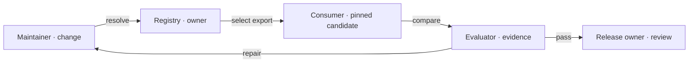
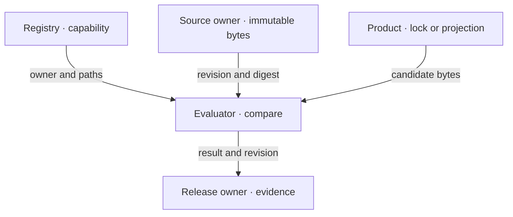

# Fleet registry and shared capability ownership

A maintainer must be able to trace shipped behavior to one source owner. The lifecycle host and products consume only the capabilities they use. Products retain their data, permissions and native execution.

## Operator rules

These artifact-bearing rules apply from admission to rollback. Each row names its evidence and failure action.

| ID | When and who | Required action and evidence | On failure |
|---|---|---|---|
| operator-rules#1 | START · change author | Resolve the capability and source owner in the existing fleet registry. Record the owner, export or source path, consumer use and affected write scope in the existing plan or review. For unregistered shared behavior, resolve ownership before adding a shared implementation. | Report a missing or competing owner. Admit scoped investigation or repair. |
| operator-rules#2 | Implementation · source owner and consumer | Change shared semantics upstream. Consume an exact owner revision through a public export, or a read-only offline projection tied to owner bytes. The consumer may supply supported configuration, callbacks, authorization, view state and native execution. | Reject a forked origin, floating runtime pin, second implementation, conflicting semantic map, package override or hand-edited projection. |
| operator-rules#3 | LAND and review · evaluator | Bind applicable proof to the candidate. Check actual resolution or projection bytes and exercise the consuming entry point with an owner fixture. Name the capability, expected owner, affected path and repair. Re-run affected checks after drift. | Stop publication on failed enrolled checks. Withhold promotion when required behavioral proof is missing. Resolve semantic ambiguity through owner review. |
| operator-rules#4 | Release and rollback · release owner | Integrate the verified upstream first, then advance consumer pins under their own required checks. Revert an incompatible consumer to its last verified canonical revision and matching projection. Retain exact source and release receipts. | Keep the last verified delivery active. Recheck when owner bytes, pin, route, policy or candidate changes. |

Compatibility paths may forward a contract or serve verified generated bytes. Owner-defined configuration and byte-equivalent version skew follow the owner’s convergence rules. Reject dependency cycles, silent fallbacks and downstream patches in governed releases.

## PRD

**FR-1.** Existing products consume packages and offline files. A passing build can conceal a replacement. Lifecycle governance must identify one owner and show the reviewer which implementation the consumer selected.

| Priority | User story and pain | Verifiable condition of completion |
|---|---|---|
| Must · V1 | As a contributor, find the responsible owner before creating a competing implementation. Ownership ambiguity is an observed structural risk. | The same registry resolves the five pilot owner domains. Both workflow documents point to these operator rules. The workflow contract evaluator rejects a missing binding. |
| Must · V2 | As a maintainer, distinguish an authentic offline copy from an edited one. Offline copies already serve real consumers. | Accepted projection bytes hash to the declared pin. An explicit audit compares them with the registered source at the owner commit. A one-byte edit fails. |
| Must · V3 | As an integrator, identify the dependency and route a product actually selects. | The declared and locked package agree on canonical origin and revision. The pilot gateway route retains its registered static import. A fork, override or direct local replacement fails. The consumer smoke supplies separate execution evidence. |
| Should · V4 | As a release operator, establish that consumers actually enforce this contract. | Each participating consumer pins a released lifecycle tool, runs its required check on the candidate, and records one positive and one negative entry-point result. Open until each consumer provides its own receipt. |
| Won't this increment | Prove semantic equivalence of arbitrary rewritten code, impose unused dependencies, or add a hosted registry. | Review suspicious parallel implementations against the owner’s fixtures. Revisit automation only if a specific recurring escape warrants it. |

Pilot targets are three accepted real consumers, three refused substitutions, and ten minutes to the first useful finding from a prepared checkout. Uncoached timing is unmeasured. Mobile and edge products keep their offline artifacts.

## TAD

The registry owns capability ID, source identity, consumers and optional proof bindings. Products own their lockfiles, source pins and delivered copies. The verifier reads committed objects and reports the candidate revision and checks performed. An empty check list proves no adoption.

| Surface | Positive proof | Remaining boundary |
|---|---|---|
| Package | Consumer manifest, resolved lock entry, canonical origin, exact commit and integrity field agree. The explicit audit also locates the registered source in the canonical owner checkout. | The native installer verifies the archive. Actual behavior needs the consumer fixture. |
| Projection | Registered source path and revision, declared digest and delivered file match. Verify a new pin against cached owner bytes. | An unchanged protected pin can be reused for an affected candidate. The explicit audit reads the owner bytes again. |
| Product entry | The registered direct import remains present and the consumer runs its established product test. | Static inspection detects a known substitution. It cannot prove a retained import is used, detect every alias, or authorize provider access. |
| Lifecycle | START checks relevant declared paths against the fetched baseline, reports drift and allows repair. LAND checks touched enrolled inputs at the committed candidate before pushing. | Independent pushes and consumers on older tool versions require a protected CI gate for equivalent coverage. |

**Diagram FR-1** · Class: user workflow · Notation: flowchart LR · Surface: 2d canvas · Version: 1 — 2026-11-23

A failed check routes the change back for repair.



**Diagram FR-2** · Class: data flow · Notation: flowchart TB · Surface: 2d canvas · Version: 1 — 2026-11-23

Evidence stays local to the evaluator.



FR-1 covers journey and workflow. FR-2 covers data flow and topology. Agent orchestration is inapplicable to a deterministic checker. Evidence contains repository, revision, path and digest. Credentials and product data stay local.

### Owner and consumer bindings — reference implementation

The [fleet registry](../catalog/fleet-ownership.json) owns the assignments. The table explains their scope.

| Domain | Source owner and interface | Consumer boundary and proof |
|---|---|---|
| Gateway | `agentic-gateway` owns resolution, connector profiles and shared prompt preset authoring. | OS preserves the pinned preset compatibility path. Graph imports the HyperFrames connector. Trading owns consent for native reads. API, MCP, WebMCP, skills, commands and `/`, `@`, `#` may expose a capability through an adapter. Each host retains its execution grants. |
| Design | `agentic-design-system` owns shared UI tokens, themes, semantic controls, panels and public adapters. | Base, Sheets, Graph, Commerce and other products supply supported roles and callbacks. Use the [design ownership contract](DESIGN-SYSTEM-OWNERSHIP.md) and its [consumer matrix](../catalog/design-consumer-matrix.json). |
| Workbooks | `agentic-sheets` owns workbook/formula semantics and its published storage interface. | Base’s `check:sheets` passed for its 20-file sealed export. |
| Records | `agentic-base` owns Base record operations and reusable record views. | Graph and Commerce retain product data and access policy. Base’s `check:browser-data-view` passed with its locked Design System source in an isolated checkout. The local installation had stale exports. |
| Geography | `agentic-geo` owns longitude normalization, wrapped spans and unwrapping. | Commerce pins and projects the core. Graph consumes the package. Products retain map rendering, coordinate validation and publication policy. |

OS owns governance. The [fleet checker](../bin/agentic-os-fleet.mjs) checks declared ownership and planning conflicts. The [reuse checker](../scripts/check-fleet-reuse.mjs) checks enrolled consumption. The design matrix remains the token-alignment authority.

## ADR

**FR-A1.** Extend the existing registry with optional consumer proofs. Keep ownership independent of language, transport and vendor. Qualify each new delivery format with an owner-backed fixture.

| Alternative | Trade-off and decision |
|---|---|
| Independent per-product registries | Easy to introduce, but each can appoint a different owner. Declined. |
| One hosted gateway for every call | Centralizes execution, adds availability and permission dependencies, and impairs offline use. Declined. |
| One registry with direct imports and verified projections | Preserves existing offline products, source ownership and native authority. Selected. The cost is pin migration and an independent check per affected boundary. |

Revisit when a new format or repeated substitution escapes a check. Revert a checker with its bindings and a consumer with its prior pin. Each effect requires its own authority.

## MVP

**Demo.** Find an unfamiliar capability’s owner, audit the consumer, alter one fixture, observe the refusal, then restore the canonical input. Run the product smoke for behavioral evidence.

### Evidence and reproduction — reference implementation

Run from `agentic-os`. The audit reads committed HEAD and cached owner origin/main. Graph’s TypeScript check uses Node 22.13+ without executing the module.

```sh
node bin/agentic-os-fleet.mjs --discover --query=gateway
node scripts/check-fleet-reuse.mjs --root=/workspace/agentic-os --owner-root=/workspace/agentic-gateway
node scripts/check-fleet-reuse.mjs --root=/workspace/agentic-commerce-os --owner-root=/workspace/agentic-geo
node scripts/check-fleet-reuse.mjs --root=/workspace/agentic-graph --owner-root=/workspace/agentic-gateway
node --test __tests__/fleet.test.mjs
npm run evals
```

| VCC | Evidence at this authoring handoff | Remaining proof |
|---|---|---|
| V1 | Fleet discovery tests exercise distinct registered owners. The required OS budgets workflow runs `npm run evals`, including the workflow-link and registry check. | A released consumer must adopt the corresponding OS revision. |
| V2 | Explicit audit accepted OS presets at consumer `0a6192b64` and Commerce Geo at `0fb7efbcc`. The sealed projection regression changes one byte in an isolated candidate. | Recheck authenticated source when a pin changes. |
| V3 | Explicit audit accepted Graph’s declared dependency, lock and route at `efa485ec9`. Fork and route replacement fixtures exercise refusal. The [Graph browser fixture](https://github.com/huijoohwee/agentic-graph/pull/2070) covers preview and decoded export. | Run product behavior again on any changed route. |
| V4 | Design-token conformance passed for the six entries in its existing matrix. The new audit covered the three bindings above. | Protected negative results from independently pinned consumers and clean-session timing are outstanding. |

Local checks passed for 30 fleet tests and 11 runtime-budget tests. Both diagrams projected (10 nodes, 9 edges). Net startup-document growth was zero bytes.

The [full inventory](../FLEET.md#cross-repository-source-ownership) stopped on existing missing planning identity in both predecessor and candidate. Finding `artifact-naming-noncompliant` · major · operator-rules#1 · `guides/DESIGN-SYSTEM-PANEL-OWNERSHIP.md` · missing `continuity_id` · documentation owner must classify or complete its frontmatter and rerun the inventory. The three pilot audits are independently reproducible.

## GTM

**Segment and channel.** Test avoided rework with maintainers of multiple products at their next affected review. Incident rate, market size and willingness to pay are unknown.

**Pilot.** With outreach authority, offer one $1 assisted audit. Continue if all seeded substitutions fail and an uncoached reviewer identifies the fix within ten minutes. Repair any false rejection before expanding. Revisit the channel if no buyer responds within seven days of an offer. Payment and revenue are unobserved.

**Bounds.** Target 30 active minutes, 16 KiB for the plan, ≤500 net startup bytes and one lazy checker. Zero product runtime modules, paid effects or model calls in validation. Authoring tokens are unmetered. Qualify the lifecycle owner first, then each independent consumer on its next pin. Recheck external gates on a result or missing owner object becoming available.

## Coverage and decision record

All dispositions join `fleet-registry@1.0.0`. Each role owns its next evidence. Deferred items reopen on the stated trigger.

| ID | Disposition | Evidence or reason · owner and trigger |
|---|---|---|
| C01 | Covered | PRD names maintainer, job, workaround and uncertainty · Product |
| C02 | Deferred | Reach and market size need observed incidents and buyer interviews · Product after pilot |
| C03 | Covered | ADR alternatives and GTM $1 hypothesis · Product |
| C04 | Covered | V1–V3, offline journey and ten-minute target · Product |
| C05 | Covered | Two data/workflow views and source boundaries · Architecture |
| C06 | Covered | Exact revisions, integrity checks, missing-proof refusal, local data · Engineering |
| C07 | Covered | FR-A1 records the selected design, trade-offs and recovery · Architecture |
| C08 | Covered | MVP records three committed consumer audits and negative fixtures · Evaluation |
| C09 | Deferred | No funnel or retention observations · Product after authorized cohort |
| C10 | Covered | Repair at owner, pre-publication checks and reviewed rollback · Release |
| C11 | Covered | Consumers retain native authority and source-license obligations · Source owner at adoption |
| C12 | Deferred | Active labor, saved rework and demand have no measured unit economics · Finance after pilot |
| C13 | Not applicable | Internal zero-spend increment has no capital request · Sponsor on funding decision |
| C14 | Covered | START, ADLC, candidate check and release proof per effect · Release |
| C15 | Not applicable | No external audience requested a deck, plan or financial model · Product on audience request |
| C16 | Covered | Seven-day decision window and stop condition · Product |

Next, the release owner must verify a negative candidate in each consumer’s protected gate. Record source, delivery and payment separately.
